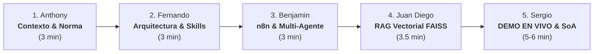

# 🎓 MASTERCLASS & GUÍA MAESTRA DE EXPOSICIÓN
## Agente Inteligente de Evaluación de Controles y Declaración de Aplicabilidad (SoA)
### Proyecto Integrador de Auditoría de Sistemas (ISO/IEC 27701:2025 & Ley N° 29733)
**Universidad Nacional de San Agustín de Arequipa (UNSA)**  
*Escuela Profesional de Ingeniería de Sistemas (EPIS)*  
*Docente: Mg. Edward Vicente Zárate Carlos*

---

## 📌 1. Estrategia y Dinámica del Equipo

### Regla de Oro de la Presentación
> **"No somos estudiantes leyendo diapositivas; somos un equipo de Auditores e Ingenieros de Inteligencia Artificial que implementaron una solución de nivel empresarial para la gobernanza de privacidad de la UNSA."**

- **Tiempo Total Estimado:** 15 a 20 minutos (3 a 4 minutos por integrante).
- **Ritmo:** Fluido, sin silencios incómodos. Cada integrante presenta a su compañero con una transición técnica natural (*"Y para entender cómo se conecta este flujo con el resto de la universidad, los dejo con Benjamin..."*).
- **Setup Técnico Previsto:**
  1. Terminal con `python app.py` levantado en `http://localhost:5000`.
  2. Navegador en pantalla completa con el **Dashboard Web** (`static/index.html`).
  3. Pestaña secundaria con el flujo gráfico de **n8n** (`workflow_n8n_pims_unsa.json`).
  4. Visual Studio Code con el código de `agents/controles.py`, `rag.py` y `skills/generar-soa/SKILL.md`.

---

## 👥 2. Resumen de Asignación de Roles

| # | Expositor | Rol y Título del Módulo | Elemento Clave que Expone |
|---|---|---|---|
| **1** | **Anthony** | **El Reto Institucional y Marco PIMS** | Problema en la UNSA, Ley 29733, ISO/IEC 27701:2025 y por qué falla la auditoría manual. |
| **2** | **Fernando** | **Ingeniería de Agentes: "De Prompt a Skill"** | Por qué un LLM libre es un peligro, arquitectura determinista de Skills, motor de reglas booleanas. |
| **3** | **Benjamin** | **Orquestación Multi-Agente & n8n** | Pipeline institucional, integración de Inventario, Riesgos y Evidencias, contratos JSON tipados. |
| **4** | **Juan Diego** | **Núcleo RAG Semántico y FAISS** | Embeddings locales, modelo multilingüe MiniLM, similitud coseno, vinculación de normativas y directivas. |
| **5** | **Sergio** *(Estrella)* | **DEMO EN VIVO, Declaración SoA, Detección de Brechas y Gobernanza** | Ejecución en tiempo real del Dashboard, evaluación de SISUNSA y Comedor, prescripciones, exportación y Human-in-the-Loop. |

---

---

## 🎙️ 3. Guion Detallado Minuto a Minuto

---

### 👤 INTEGRANTE 1: ANTHONY
#### 🎯 Título: *"La Crisis de Privacidad en la Educación Superior y el Marco ISO/IEC 27701:2025"*
- **Tiempo:** 00:00 – 03:00 (3 minutos)
- **Objetivo:** Poner al jurado en tensión. Demostrar la gravedad del problema en la UNSA y justificar la necesidad del estándar internacional.
- **Qué mostrar en pantalla:** Diapositiva del contexto UNSA (sistemas SISUNSA, Comedor con biometría, admisiones) + Estructura de la norma ISO/IEC 27701:2025.

#### 🗣️ Guion / Pitch Verbal:
> "Buenos días profesor Edward Zárate y compañeros. Hoy les presentamos una solución de vanguardia en auditoría de sistemas: el **Agente de Evaluación de Controles y Declaración de Aplicabilidad (SoA)** para el Sistema de Gestión de Privacidad de la UNSA.
>
> Para entender el valor de este sistema, veamos la realidad de nuestra universidad: la UNSA gestiona datos personales y sensibles de más de 25,000 estudiantes y miles de docentes. Datos bancarios en matrículas, notas en **SISUNSA**, imágenes de videovigilancia y, de manera crítica, **huellas dactilares biométricas en el Comedor Universitario**.
>
> Bajo la **Ley N° 29733 de Protección de Datos Personales del Perú**, las multas por indebida custodia de datos sensibles pueden superar los cientos de miles de soles. A nivel internacional, el estándar dorado para resolver esto es la **ISO/IEC 27701:2025**, la norma de Gestión de Información de Privacidad (PIMS), estructurada con la cláusula 6.1.3 y su catálogo del Anexo A.
>
> ¿Cuál es el problema tradicional? Que auditar si se cumplen estos controles toma meses, cientos de páginas en Excel propensas al error humano y un desfase enorme con las evidencias reales. Nuestro proyecto transforma este cuello de botella mediante **Inteligencia Artificial Agentica y determinismo normativo**. Y para explicar cómo diseñamos el cerebro de este agente, le cedo la palabra a Fernando."

- **Palabras Clave de Impacto:** *PIMS (Privacy Information Management System), Ley 29733, PII (Personally Identifiable Information), Cláusula 6.1.3, Anexo A.*
- **Transición:** *"Y para explicar cómo superamos las limitaciones de los LLMs tradicionales mediante una arquitectura robusta de software, los dejo con Fernando."*

---

### 👤 INTEGRANTE 2: FERNANDO
#### 🎯 Título: *"Ingeniería de Agentes: Del 'Prompt Engineering' a la Arquitectura Determinista de Skills"*
- **Tiempo:** 03:00 – 06:00 (3 minutos)
- **Objetivo:** Demostrar madurez técnica de ingeniería de software. Explicar por qué NO se usó un chat genérico y cómo opera el motor de reglas.
- **Qué mostrar en pantalla:** El archivo `skills/generar-soa/SKILL.md` y el diagrama de clases/métodos de `agents/controles.py` (`_aplica`, `_estado`, `_fila`).

#### 🗣️ Guion / Pitch Verbal:
> "Gracias, Anthony. Cuando se habla de IA en auditoría, el primer error común es pensar en colocar un prompt en un modelo masivo como ChatGPT y pedirle: *'Revisa si cumplimos la norma'*. En auditoría y cumplimiento legal, **eso es inaceptable**. Un LLM puro alucina, no es determinista y no ofrece garantías matemáticas de reproducibilidad.
>
> Por eso, nuestro equipo adoptó el paradigma moderno: **'De Prompt a Skill'**. Nuestro agente no es un simple chat; es un sistema modular compuesto por dos capas:
>
> 1. **La Capa de Habilidades (Skills):** Definidas formalmente bajo especificaciones YAML y esquemas JSON estrictos. Tenemos la **SKILL-01 (`generar-soa`)** para la evaluación integral y la **SKILL-02 (`verificar-controles`)** para inspecciones quirúrgicas de un solo control.
>
> 2. **El Motor de Reglas Determinista en Python:** En el archivo `agents/controles.py`, implementamos la lógica formal del estándar ISO 27701:
>    - Discrimina si la organización actúa como **Responsable** (*PII Controller*, controles A.1), como **Encargado** (*PII Processor*, controles A.2) o bajo **Controles Comunes** (A.3).
>    - Aplica el principio de **integridad probatoria**: un control jamás se marca como 'Implementado' por fe o texto libre; requiere un artefacto documental verificado. Si tiene borrador es 'Parcial', y si carece de evidencia es 'No implementado'.
>
> Con esto garantizamos que la auditoría sea 100% reproducible y auditable. Pero un agente aislado no sirve si no conversa con la infraestructura universitaria. Para ver cómo se orquesta con otros agentes, le doy el pase a Benjamin."

- **Palabras Clave de Impacto:** *Paradigma De Prompt a Skill, No-repudio, Determinismo algorítmico, PII Controller vs Processor, Integridad probatoria.*
- **Transición:** *"Para ver cómo nuestro agente se integra con el ecosistema universitario a través del bus de orquestación, Benjamin nos explicará el flujo n8n."*

---

### 👤 INTEGRANTE 3: BENJAMIN
#### 🎯 Título: *"Orquestación Multi-Agente en n8n y Protocolo de Interoperabilidad Tipada"*
- **Tiempo:** 06:00 – 09:00 (3 minutos)
- **Objetivo:** Mostrar cómo encaja el Agente de Controles dentro del ecosistema integral de la UNSA.
- **Qué mostrar en pantalla:** El archivo `workflow_n8n_pims_unsa.json` o la interfaz gráfica del canvas de **n8n** con los 6 nodos conectados.

#### 🗣️ Guion / Pitch Verbal:
> "Gracias, Fernando. La auditoría moderna no la hace una sola entidad; la realiza un consorcio de agentes especializados cooperando en tiempo real. En la UNSA diseñamos una arquitectura multi-agente orquestada mediante **n8n**:
>
> 1. **Agente de Inventario (Puerto 5001):** Mapea los sistemas de la universidad (SISUNSA, Comedor, Admisión) y cataloga los flujos de datos personales.
> 2. **Agente de Riesgos (Puerto 5002):** Analiza amenazas de privacidad y emite evaluaciones de impacto (DPIA), vinculando riesgos como el `R-UNSA-01` (filtración de notas) a controles específicos.
> 3. **Agente de Evidencia (Puerto 5003):** Recolecta resoluciones rectorales, manuales y logs técnicos de la OTIC.
>
> Aquí es donde entra nuestro nodo: **El Ensamblador del Contrato Tipado**. Este nodo unifica las salidas de los tres agentes en un payload JSON canónico y lo envía mediante HTTP POST a nuestro endpoint `/api/controles/ejecutar`.
>
> Nuestro Agente de Controles procesa la petición en milisegundos y devuelve la SoA calculada. Y observen la inteligencia del flujo: el orquestador tiene un **nodo condicional IF**: si nuestro agente detecta brechas críticas (controles sin implementar), automáticamente bifurca el flujo, genera un ticket de alerta y notifica al Oficial de Protección de Datos (DPO) con las tareas asignadas a cada responsable. Si todo está conforme, emite la SoA para firma digital.
>
> Pero, ¿cómo hace el agente para fundamentar normativamente sus respuestas conceptuales y cruzar controles con directivas internas? Para eso creamos un motor RAG, y Juan Diego nos explicará cómo funciona."

- **Palabras Clave de Impacto:** *Bus de integración n8n, Arquitectura Multi-Agente, Contrato JSON canónico, Bifurcación condicional, Remediation workflow.*
- **Transición:** *"Para entender cómo el agente comprende el lenguaje natural y razona sobre las políticas de la UNSA, Juan Diego detallará el motor RAG."*

---

### 👤 INTEGRANTE 4: JUAN DIEGO
#### 🎯 Título: *"El Núcleo RAG: Embeddings Multilingües, FAISS y Repositorio Semántico"*
- **Tiempo:** 09:00 – 12:30 (3.5 minutos)
- **Objetivo:** Explicar la ingeniería detrás de la búsqueda semántica vectorial sin dependencias de APIs externas costosas.
- **Qué mostrar en pantalla:** El código de `rag.py` y la pestaña de **Búsqueda Semántica RAG** del frontend con la barra de similitud coseno.

#### 🗣️ Guion / Pitch Verbal:
> "Gracias, Benjamin. Una de las mayores virtudes de nuestro proyecto es su **soberanía tecnológica y privacidad de datos**. Al auditar datos de la UNSA, no podíamos enviar información confidencial a APIs comerciales en la nube como OpenAI. Todo nuestro pipeline corre **100% en local**.
>
> En el archivo `rag.py` construimos un motor de **Generación Aumentada por Recuperación (RAG)** de alto rendimiento:
>
> 1. **Indexación Inteligente:** La función `desde_carpeta()` lee automáticamente todos los documentos normativos de la carpeta `knowledge/`: la directiva institucional de privacidad `DIR-OTIC-004-UNSA`, el resumen normativo de la norma ISO 27701:2025 y el catálogo maestro de controles. Segmenta el texto por párrafos y extrae metadatos jerárquicos.
>
> 2. **Modelo de Embeddings Multilingüe:** Empleamos `paraphrase-multilingual-MiniLM-L12-v2` mediante SentenceTransformers. Este modelo genera vectores densos de alta fidelidad para el español técnico.
>
> 3. **Indexación Vectorial con FAISS:** Usamos `faiss.IndexFlatIP` (Inner Product). Al normalizar previamente los vectores a norma unitaria L2, el producto interno equivale con exactitud matemática a la **similitud coseno**.
>
> Cuando el agente evalúa cada control, busca en milisegundos en el índice vectorial si existe una directiva interna de la UNSA que respalde ese control con un umbral de corte estricto de $\theta \ge 0.30$. Si lo supera, asocia la política institucional directamente a la fila de la SoA.
>
> Todo esto suena excelente en teoría, pero ¿cómo se ve en la práctica? Ahora viene la parte central de nuestra presentación: **Sergio ejecutará en vivo el sistema**, simulará una auditoría completa sobre la UNSA y demostrará la generación de la Declaración de Aplicabilidad."

- **Palabras Clave de Impacto:** *Soberanía de datos, Retrieval-Augmented Generation (RAG), FAISS IndexFlatIP, Similitud Coseno, SentenceTransformers, Umbral de similitud $\theta$.*
- **Transición:** *"Y ahora, los dejo con Sergio, quien tomará el control para la demostración en vivo del sistema en tiempo real."*

---

### 👤 INTEGRANTE 5: SERGIO ⭐ *(LA PARTE ESTRELLA / SHOWSTOPPER)*
#### 🎯 Título: *"Demostración en Vivo: Generación de la SoA, Detección de Brechas Críticas y Gobernanza Human-in-the-Loop"*
- **Tiempo:** 12:30 – 18:30 (6 minutos)
- **Objetivo:** Cautivar al jurado. Interactuar en vivo con la aplicación web, ejecutar escenarios reales de la UNSA, resolver brechas y cerrar con broche de oro.
- **Qué mostrar en pantalla:** El Dashboard interactivo en tiempo real (`http://localhost:5000`), interactuando con los botones, ejecutando la SoA, mostrando filtros, el buscador RAG y la alerta de supervisión humana.

#### 🗣️ Guion / Pitch Verbal (Paso a Paso en Pantalla):

##### 1. Introducción al Dashboard (30 seg)
> "Muchas gracias, Juan Diego. Profesor Edward Zárate, jurado: nos encontramos frente a la consola oficial del **Agente de Evaluación de Controles PIMS de la UNSA**, comunicándose directamente con nuestro servidor Flask en el puerto 5000.
>
> Observen el panel superior: estamos auditando a la **Universidad Nacional de San Agustín**. Lo primero que define nuestro motor es el **Rol Organizacional**. Si la universidad actuase solo como Encargada, el sistema excluiría automáticamente los controles A.1; pero para la UNSA seleccionamos **Responsable del Tratamiento (PII Controller)**, activando los dominios A.1 y A.3."

##### 2. El Principio de Evidencias y Riesgos (45 seg)
*(Sergio señala la sección de artefactos probatorios y riesgos en pantalla)*
> "Miren aquí: el agente tiene cargados los riesgos identificados por el Agente de Riesgos: `R-UNSA-01` (Riesgo de filtración de notas y DNI en SISUNSA) y `R-UNSA-02` (Tratamiento de huellas en el Comedor Universitario sin DPIA).
>
> En evidencias documentales, contamos con la Resolución Rectoral del reglamento de SISUNSA y el Registro RAT de la OTIC, pero el protocolo de respuesta ante incidentes CSIRT está solo en borrador, calificado como **Parcial**."

##### 3. El Momento Clímax: Ejecución de la SoA en Vivo (1 min 30 seg)
*(Sergio hace click firme en el botón: **"Ejecutar Skill: Generar Declaración de Aplicabilidad (SoA)"**)*
> "Voy a disparar en este instante la ejecución de la **SKILL-01**. Observen la respuesta instantánea del agente en la parte inferior:
>
> El agente evaluó los controles normativos:
> - **Aplican a la UNSA:** 8 controles.
> - **Excluidos normativamente:** 2 controles (los A.2 específicos de encargados, con justificación jurídica automática).
> - **Implementados:** 2 controles.
> - **Parciales:** 2 controles.
> - **¡Y detecta 6 Brechas Críticas!**"

##### 4. Exploración de la Tabla Oficial y Brechas (1 min 30 seg)
*(Sergio hace scroll hacia la tabla de la SoA y usa los filtros de 'Brechas' e 'Implementados')*
> "Veamos la tabla formal de la SoA:
> - En el control **A.1.2.2** (Determinación de fines): aparece como **Implementado** porque detectó la Resolución del Consejo Universitario.
> - Miren la columna **Directiva UNSA (RAG)**: el motor vectorial de Juan Diego encontró y citó automáticamente la directiva interna `DIR-OTIC-004-UNSA`.
> - Pero observemos el control crítico **A.1.2.6: Evaluación de Impacto en la Privacidad (DPIA)**. Aparece en estado **Parcial** y con la alerta: *Vinculado a los riesgos R-UNSA-01 y R-UNSA-02*.
>
> Si bajamos a la sección de **Plan de Subsanación de Brechas**, el agente no solo critica, sino que **prescribe**: genera una instrucción técnica dirigida a los agentes responsables para remitir la documentación faltante antes de la auditoría de certificación."

##### 5. Demostración Quirúrgica: Skill Verificar Control & RAG en Vivo (1 min)
*(Sergio navega rápidamente a la pestaña '🔍 Buscador Semántico RAG' o 'Auditoría de Control Específico')*
> "Si el auditor quiere verificar un solo control, nos vamos a la pestaña de **Búsqueda Semántica**. Escribamos una consulta libre: *'¿Cómo se tramita el ejercicio de derechos ARCO en la UNSA?'*
> 
> Hacemos click en **Consultar RAG**: en menos de 200 milisegundos, el modelo local FAISS recupera el procedimiento exacto de la Directiva interna con un **Score de Similitud del 62%**, citando las fuentes normativas sin una sola alucinación."

##### 6. El Gran Cierre: Gobernanza "Human-in-the-Loop" (45 seg)
*(Sergio regresa a la SoA y señala el banner amarillo de Gobernanza)*
> "Para finalizar, quiero resaltar el principio más importante de nuestro diseño: **Gobernanza y Supervisión Humana (Human-in-the-Loop)**.
>
> Nuestro agente no reemplaza al Oficial de Protección de Datos ni al auditor humano. Como indica este panel oficial de supervisión, el agente emite una propuesta técnica fundada en evidencia. La validez legal definitiva requiere la firma digital del DPO de la UNSA y del Director de OTIC.
>
> En conclusión: hemos transformado semanas de trabajo manual y disperso en un proceso determinista, transparente, automatizado y formal bajo ISO/IEC 27701:2025.
>
> Muchas gracias. Quedamos a disposición del profesor y del jurado para sus preguntas."

---

---

## 🛡️ 4. Banco de Preguntas Trampa del Jurado (Y Cómo Responderlas)

| Pregunta Trampa del Docente / Jurado | Quién la responde | Respuesta Maestra (Técnica y Contundente) |
|---|---|---|
| **"¿Por qué no usaron la API de ChatGPT o Claude directo con un buen prompt?"** | **Fernando o Sergio** | *"Profesor, en auditoría forense y de privacidad hay dos impedimentos críticos: 1) **Confidencialidad**: no se puede enviar información de estudiantes y vulnerabilidades institucionales a servidores de terceros. 2) **Determinismo**: un LLM no garantiza que la misma SoA salga idéntica mañana. Nuestro agente usa reglas deterministas para la SoA y RAG local con FAISS, garantizando reproducibilidad y soberanía total."* |
| **"¿Qué pasa si alguien sube un PDF con texto falso diciendo que el control está implementado?"** | **Benjamin o Sergio** | *"Excelente pregunta. El Agente de Controles evalúa el **estado probatorio reportado** por el Agente de Evidencia. Pero justo por eso implementamos la cláusula de **Human-in-the-Loop**: el agente emite una propuesta con trazabilidad de qué archivo sustentó cada fila. Si la evidencia es un borrador o apócrifa, el DPO o auditor humano la rechaza en la revisión final previa a la firma."* |
| **"¿Por qué la norma separa controles A.1 y A.2?"** | **Anthony** | *"Porque la ISO/IEC 27701:2025 diferencia la responsabilidad jurídica. El Anexo A.1 es para el **Responsable** (*Controller*), quien decide el para qué y cómo del tratamiento (como la UNSA con el SISUNSA). El Anexo A.2 es para el **Encargado** (*Processor*), quien solo procesa datos por encargo de un tercero. Si confundiéramos ambos roles, la auditoría carecería de validez legal."* |
| **"¿Qué es la similitud coseno y por qué pusieron el umbral en 0.30?"** | **Juan Diego** | *"Al normalizar los embeddings a longitud 1 con FAISS `IndexFlatIP`, el producto punto es idéntico al coseno del ángulo entre los vectores. En modelos de lenguaje multilingües como MiniLM, textos semánticamente relacionados en español técnico suelen puntuar entre 0.30 y 0.70. Un umbral de 0.30 filtra falsos positivos asegurando que solo se citen políticas verdaderamente pertinentes."* |
| **"¿Cómo escala este sistema si la UNSA agrega 50 facultades y 200 controles?"** | **Sergio** | *"La arquitectura está desacoplada: el catálogo está en `catalogo_controles.json`, por lo que añadir controles no requiere reescribir código. En el backend, FAISS procesa millones de vectores en memoria en microsegundos, y el contrato JSON con n8n permite balancear la carga horizontalmente en contenedores Docker."* |

---

---

## 📋 5. Checklist de Preparación Previa a la Exposición

- [ ] **1. Entorno de Ejecución:**
  - Terminal 1: Activar entorno virtual (`source venv/bin/activate` o `.venv`).
  - Terminal 2: Correr `python app.py` y verificar que imprima: `Servidor Agente de Controles iniciado en http://127.0.0.1:5000`.
- [ ] **2. Navegador Web:**
  - Abrir `http://127.0.0.1:5000` en Chrome o Edge con zoom al 100% o 110% para buena visibilidad de los evaluadores.
  - Verificar que el indicador diga: `🟢 Agente Conectado (API :5000)`.
- [ ] **3. Pantallas de Contingencia (Por si falla internet):**
  - Recordar que el sistema funciona **100% offline** (FAISS y embeddings están descargados localmente).
- [ ] **4. Pases de Palabra:**
  - Ensayar 1 vez los pases de palabra entre Anthony ➔ Fernando ➔ Benjamin ➔ Juan Diego ➔ Sergio.
- [ ] **5. Convicción y Presencia:**
  - Hablar con voz firme, mirar al jurado y usar las manos para guiar la atención hacia la pantalla.
